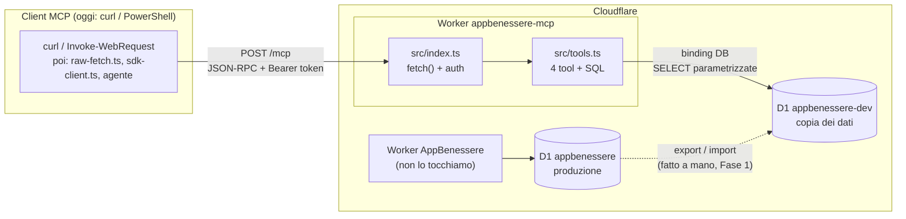
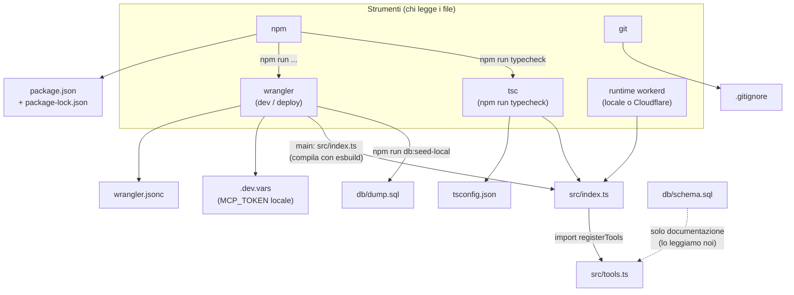
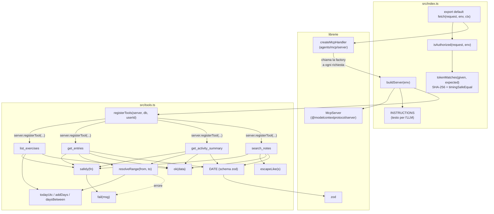
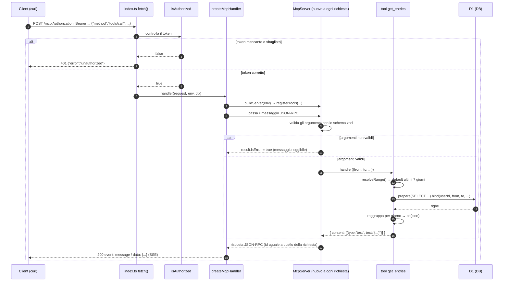
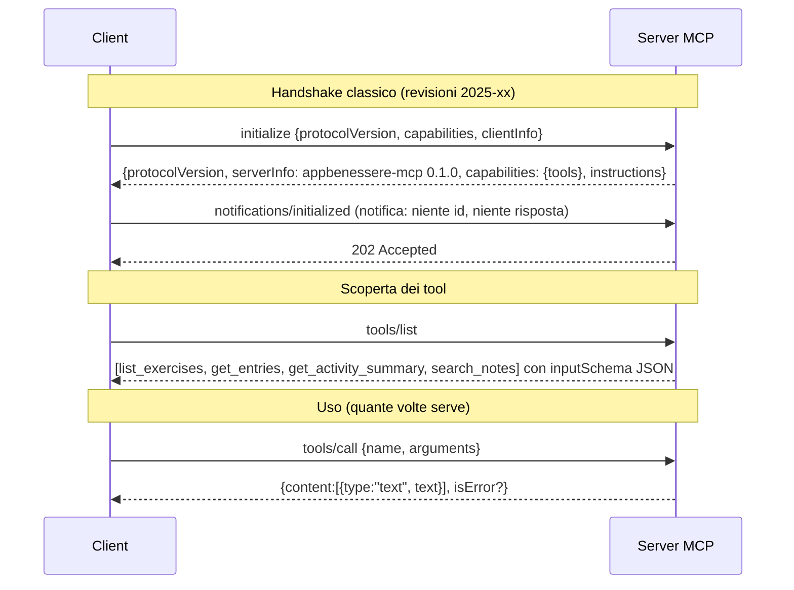
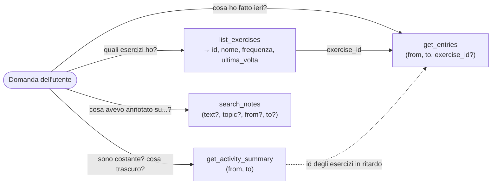
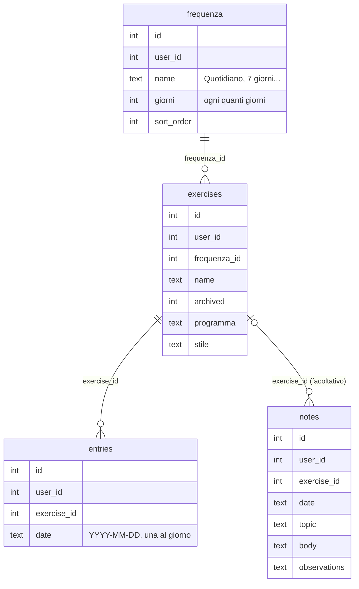

# Schemi del progetto AppBenessere MCP

> I diagrammi sono in [Mermaid](https://mermaid.js.org/): si vedono già disegnati su GitHub
> e in VS Code con l'anteprima Markdown (`Ctrl+Shift+V`, con l'estensione *Markdown Preview Mermaid Support*).
> Aggiornato al 2026-11-25: è presente solo `mcp-server/`. Client (Fase 4) e agente (Fase 5) vanno aggiunti qui quando ci saranno.

---

## 1. Architettura: chi parla con chi

In locale (`npm run dev`) c'è lo stesso schema, ma il Worker gira in **workerd** sul tuo PC
e il D1 è un file SQLite in `mcp-server/.wrangler/state/`, riempito da `db/dump.sql`.

---

## 2. File: chi usa cosa

| File | Cosa contiene | Chi lo usa | Su git? |
|------|---------------|-----------|---------|
| `mcp-server/package.json` | nome progetto, dipendenze, script `dev`/`deploy`/`typecheck`/`db:seed-local`/`tail` | npm | sì |
| `mcp-server/package-lock.json` | versioni esatte di tutte le dipendenze | npm (`npm install` / `npm ci`) | sì |
| `mcp-server/wrangler.jsonc` | nome Worker, file d'ingresso, binding `DB`, variabile `MCP_USER_ID`, secret richiesto `MCP_TOKEN`, log attivi | wrangler | sì |
| `mcp-server/.dev.vars` | `MCP_TOKEN=...` per l'uso in locale | `wrangler dev` | **no** |
| `mcp-server/tsconfig.json` | regole TypeScript, tipi dei Workers | `tsc` ed editor (wrangler non lo usa per compilare) | sì |
| `mcp-server/src/index.ts` | punto d'ingresso HTTP, controllo token, creazione del server MCP | runtime del Worker | sì |
| `mcp-server/src/tools.ts` | i 4 tool, schemi zod, query SQL, funzioni di supporto | `index.ts` | sì |
| `mcp-server/README.md` | istruzioni d'uso e checklist | noi | sì |
| `db/schema.sql` | struttura del DB dell'app | noi (riferimento per scrivere le query) | sì |
| `db/dump.sql` | schema + **dati reali** | `npm run db:seed-local` | **no** |
| `.gitignore` | cosa git deve ignorare | git | sì |
| `.wrangler/`, `node_modules/` | stato locale (D1 locale, cache) e librerie installate | wrangler / npm | no |
| `PIANO-MCP-APPBENESSERE.md`, `SCHEMI.md` | piano e schemi | noi | sì |
| `DBDEV` | appunti su `appbenessere-dev` | noi | sì (attenzione: non metterci token) |

---

## 3. Dipendenze tra le funzioni (dentro il codice)

---

## 4. Il viaggio di una richiesta `tools/call`

Punti chiave:
- **Stateless**: il server MCP viene ricreato a ogni richiesta, quindi non esiste `Mcp-Session-Id`.
- `userId` arriva da `MCP_USER_ID` in `wrangler.jsonc`, **mai** dagli argomenti del tool.
- Gli errori "di dominio" (data sbagliata, intervallo troppo ampio, eccezione SQL) tornano come `isError: true` dentro una risposta **riuscita**: l'LLM li legge e può correggersi.
  Un tool inesistente invece è un errore di protocollo JSON-RPC (`-32602`).

---

## 5. Ciclo di vita del protocollo (cosa fa un client)

Con la revisione 2026-07-28 il client può saltare l'handshake (`server/discover` + header `MCP-Protocol-Version`):
per questo nei test con `curl` basta mandare direttamente `tools/list` con `MCP-Protocol-Version: 2025-11-25`.

---

## 6. Dipendenze tra i tool (come li concatena un agente)

L'unica dipendenza "dura" è `exercise_id`: per filtrare `get_entries` su un esercizio
bisogna prima conoscerne l'id con `list_exercises` (o leggerlo da `get_activity_summary`).
Gli altri tool sono indipendenti tra loro.

---

## 7. Tabelle del database usate dai tool

| Tool | Tabelle lette |
|------|---------------|
| `list_exercises` | `exercises`, `frequenza`, `entries` (per `ultima_volta`) |
| `get_entries` | `entries`, `exercises` |
| `get_activity_summary` | `exercises`, `frequenza`, `entries` |
| `search_notes` | `notes`, `exercises` |

**Mai lette**: `users` (hash delle password), `sessions` (token), `chat_conversations`, `chat_messages`, `exercises_master`, `d1_migrations`.
